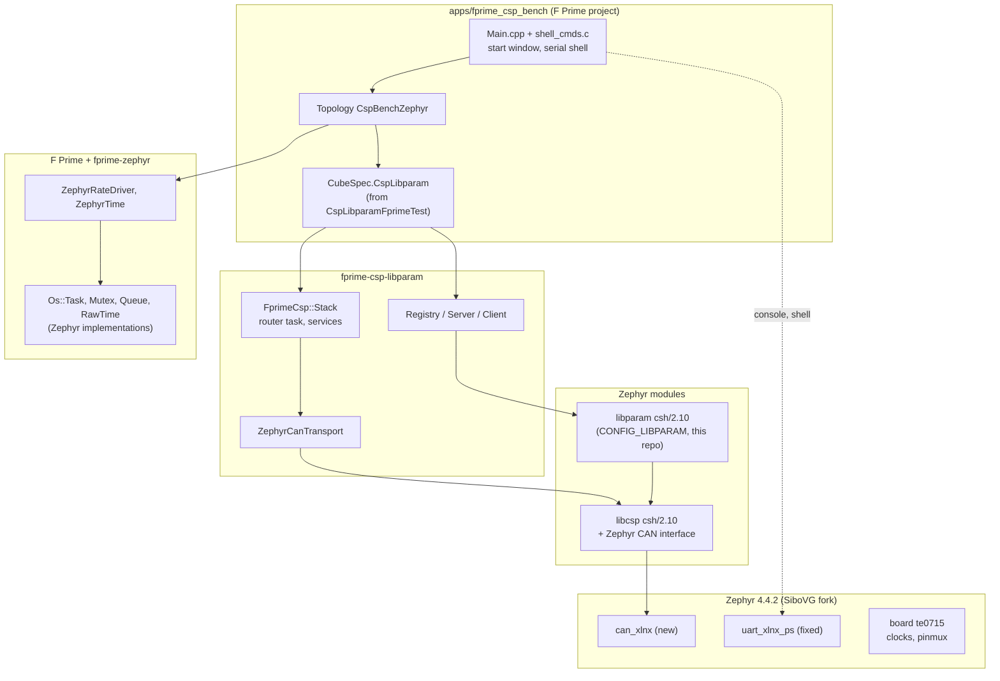
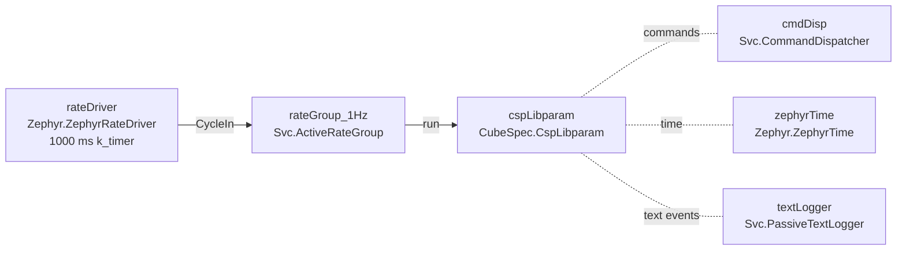
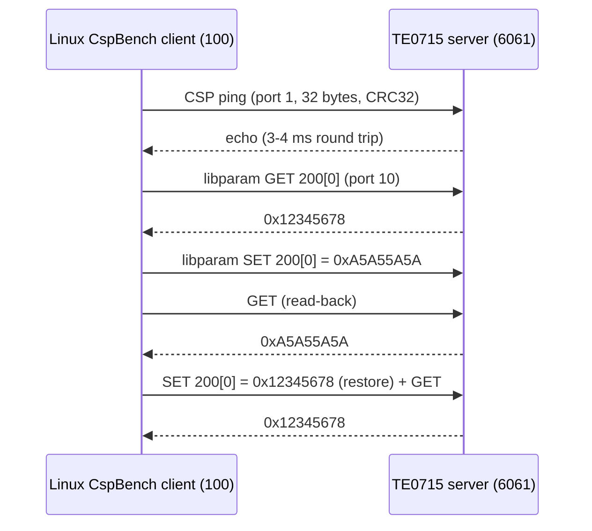

# Architecture

## Software layers

## How the builds fit together

| Build | Driven by | Notes |
|---|---|---|
| Zephyr apps (`.`, `apps/can_bringup`, `apps/csp_node`) | `west build` | This repository is a Zephyr module (`zephyr/module.yml`): it provides the `te0715` board root and the `CONFIG_LIBPARAM` build of libparam |
| F Prime app (`apps/fprime_csp_bench`) | `fprime-util` | The project's `CMakeLists.txt` calls `find_package(Zephyr)` before `project()`; fprime-zephyr's `register_fprime_zephyr_deployment()` turns the deployment into Zephyr's `app` target |
| Linux `CspBench` | `fprime-util` in CspLibparamFprimeTest | Unchanged Linux build with SocketCAN |

In the F Prime app, libcsp's `csp` target and this repository's `libparam` target come
from the Zephyr modules; `fprime-csp-libparam` uses an existing `csp` target (it
checks `CSP_USE_RDP=ON`) and an existing `fprimecsp_libparam_c` target, which the
project aliases to `libparam`.

### Pinned dependencies (`west.yml`)

| Project | Revision | Why this one |
|---|---|---|
| zephyr | SiboVG `te0715-can-v4.4.2` (`70b56a2`) | v4.4.2 + UART fixes + CAN driver |
| libcsp | `csh/2.10` (`5a95e5c`) | Matched pair used by fprime-csp-libparam and the FlatSat |
| libparam | `csh/2.10` (`d78da56`) | idem |
| fprime | `35d4c0e` (v4.2.0-267) | Pinned by fprime-csp-libparam |
| fprime-zephyr | `6e2a411` | Last revision before nasa/fprime#5615 (RawTime), which the pinned F Prime lacks |
| cmsis, cmsis_6 | from Zephyr | The only Zephyr modules the Cortex-A9 build needs |

The patches applied on top are listed in [Drivers and patches](drivers.md#patches).

## F Prime topology

The topology is the minimal subset of the Linux `CspBench` topology that runs without
a ground link: events are printed on the console; there is no GDS link or telemetry
downlink. `Main.cpp` configures the component as a server (`--role server`), with
parameter 200 (`u32`, initial value `0x12345678`), on the node chosen at boot.

## Threads and priorities

F Prime priorities are mapped to Zephyr priorities as `99 - p`
(`CONFIG_NUM_PREEMPT_PRIORITIES=100`, fprime-zephyr patch 0003). Measured with
`kernel thread list` on the board:

| Thread | F Prime priority | Zephyr priority | Stack use |
|---|---|---|---|
| `main` (drives `rateDriver.cycle()`) | - | 0 | 2412 / 16384 |
| libcsp CAN RX thread | - | -1 (cooperative) | 384 / 4096 |
| `cmdDisp` | 44 | 55 | 1664 / 16384 |
| `rateGroup_1Hz` | 43 | 56 | 1824 / 16384 |
| `cspLibparam` | 42 | 57 | 1864 / 16384 |
| `CspRouter` (libcsp router) | default | 99 | 384 / 16384 |
| `shell_uart` | - | 99 | 1204 / 8192 |

All F Prime tasks come from Zephyr's dynamic thread pool, whose stacks are all
`CONFIG_DYNAMIC_THREAD_STACK_SIZE` (16 KiB); fprime-zephyr requires every F Prime
task to use exactly that size.

## One test cycle on the bus

The Linux `CspBench` client (node 100) against the board (node 6061), one of the
five cycles of the acceptance test:

## Board support (`boards/trenz/te0715`)

| Item | Implementation |
|---|---|
| SoC | xc7z030 (confirmed by `PSS_IDCODE` = `0x1372C093`) |
| Console | UART0 on MIO14/15, 115200 8N1, pinctrl in `te0715-pinctrl.dtsi` |
| Timer | ARM global timer at CPU/2 = 333.33 MHz |
| DDR | 1 GiB at 0x0 |
| LED | D4 on MIO7 (`led0`) |
| CAN1 | MIO12 (TX) / MIO13 (RX) by pinctrl; `CAN_REF_CLK` = IO PLL 1000 MHz / 5 / 2 = 100 MHz set by `board.c`, because the reference design's FSBL leaves CAN disabled |
| JTAG | `board.cmake` + `support/xsdb.cfg`: reset, `ps7_init`, load into DDR |
| TE0701 overlays | `boards/te0715.overlay` (Pmod GPIO), `boards/te0701-can1.overlay` (CAN1 at 1 Mbit/s as `zephyr,canbus`) |
