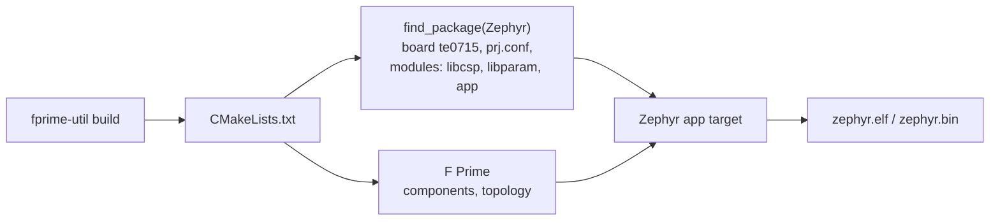
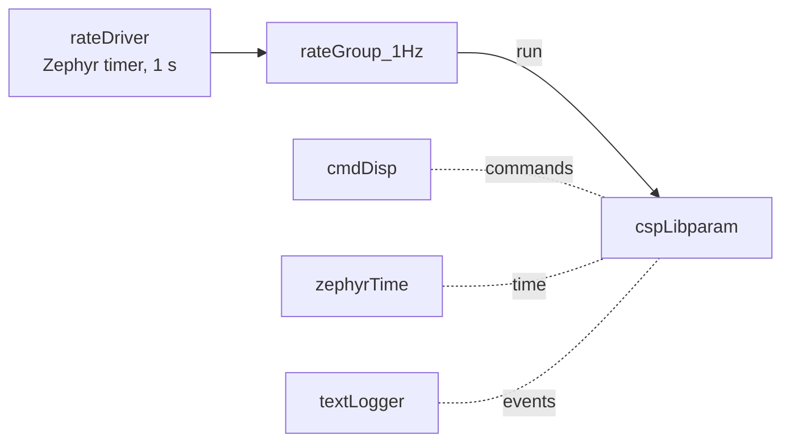
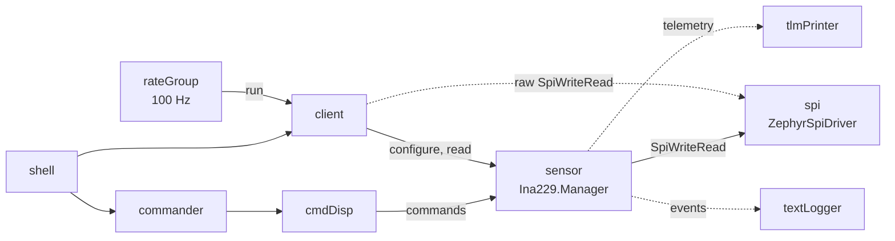

# F Prime on Zephyr

## Why the same component

The Linux acceptance bench (CspLibparamFprimeTest) proves that the F Prime
`CspLibparam` component interoperates with the pinned libcsp and libparam over
SocketCAN. Running *that same component* on the TE0715 means the Zephyr test checks
the flight-software code, not a rewrite. Only the transport underneath changes:

| | Linux bench | TE0715 |
|---|---|---|
| Component | `CubeSpec.CspLibparam` | same |
| Library | fprime-csp-libparam | same |
| Transport | `SocketCanTransport` (Linux SocketCAN) | `ZephyrCanTransport` (Zephyr CAN API) |
| OS layer | F Prime Linux/POSIX | fprime-zephyr |
| Configuration | command line (`--role server ...`) | `Main.cpp` and the boot-time `bench start` |

The component selects the transport at compile time: fprime-csp-libparam's Zephyr
module defines `FPRIMECSP_HAVE_ZEPHYR_CAN`. The Linux build is unchanged.

## How the build works

In a Zephyr application, Zephyr's CMake is in charge. In an F Prime project, F Prime's
is. [fprime-zephyr](https://github.com/fprime-community/fprime-zephyr) combines the
two: the project's top-level `CMakeLists.txt` calls `find_package(Zephyr)` first,
which sets up the cross-compiler and builds Zephyr and its modules, and then includes
F Prime. A special registration function makes the F Prime deployment into Zephyr's
`app` target.

libcsp and libparam come from the Zephyr modules. fprime-csp-libparam normally
builds them itself, but it uses an existing `csp` target when there is one (and checks
that it was built with RDP support), and an existing `fprimecsp_libparam_c` target,
which the project points at the Zephyr `libparam` library.

Three settings were needed to make F Prime build and run on this target:

| Setting | Why |
|---|---|
| `config/PlatformCfg.fpp` with larger OS handle sizes | F Prime reserves fixed space for each OS object; the Zephyr versions contain kernel objects, such as a thread with floating-point context, that are much larger on the Cortex-A9 than the defaults |
| C++ compile features declared in `CMakeLists.txt` | CMake cannot detect them for Zephyr's cross-compiler, and the libraries request C++17 |
| `CONFIG_DYNAMIC_THREAD_STACK_SIZE=16384` for every task | fprime-zephyr creates F Prime tasks from a pool of equal-sized stacks |

## Topology

This is the smallest part of the Linux `CspBench` topology that runs without a ground
station: events are printed on the serial console, and there is no telemetry downlink.
The command dispatcher is there because the component registers commands at start-up.

## Threads and priorities

In F Prime, a higher priority number means more important; in Zephyr, a lower number
does. fprime-zephyr passed F Prime's numbers through unchanged and limited them to
14, so all F Prime tasks ended up at the same, lowest priority. With the patch
(`0003`), priority `p` becomes Zephyr priority `99 - p`
(`CONFIG_NUM_PREEMPT_PRIORITIES=100`), which keeps the order.

Measured with `kernel thread list` on the board:

| Thread | F Prime priority | Zephyr priority | Stack used |
|---|---|---|---|
| `main` (drives the rate driver) | – | 0 | 2412 of 16384 bytes |
| libcsp CAN receive | – | −1 (cooperative) | 384 of 4096 |
| `cmdDisp` | 44 | 55 | 1664 of 16384 |
| `rateGroup_1Hz` | 43 | 56 | 1824 of 16384 |
| `cspLibparam` | 42 | 57 | 1864 of 16384 |
| `param_server` (libparam list service, port 12) | – | 10 | 368 of 4096 (idle) |
| `CspRouter` (libcsp router; runs every CSP callback, the libparam server included) | 45 (`CONFIG_APP_CSP_ROUTER_PRIORITY`) | 54 | 384 of 16384 |
| `shell_uart` | – | 99 | 1204 of 8192 |

## The serial shell and the start window

`shell_cmds.c` adds the `bench`, `csp` and `param` commands to Zephyr's shell (see
[The serial shell](../guide/shell.md)). Before `Main.cpp` sets up the topology it
waits for `bench start` or the end of the start window, so the CSP node can be chosen
at boot. The shell's `csp` and `param` commands use libcsp and libparam directly.

## Parameters outside the component

The F Prime component serves parameter 200. The LED parameter `led_d4` (201) is
added by the application, next to it, in `shell_cmds.c`: a `param_t` with a change
callback that drives the `led0` GPIO, registered with `param_list_add()`. libparam's
server on port 10 serves every parameter in its list, so no change to the component
was needed. To let csh load the list, `bench_start_services()` also starts libparam's
`vmem_server_loop` in its own thread (`param_server`), which answers list requests on
port 12 (and vmem requests on port 13, unused here).

## The sensor benches

`apps/fprime_ina229_bench` and `apps/fprime_adxl355_bench` run the fprime-ina229 and
fprime-adxl355 components unchanged, over fprime-zephyr's `ZephyrSpiDriver` on SPI1
(see [SPI sensor benches](../tests/spi-sensors.md)). Components they share are an F Prime
library inside this repository, `app/fprime-bench/` (listed in each bench's
`settings.ini`):

| Component | What it does |
|---|---|
| `TeBench.ShellCommander` | Builds a command packet (packet type, opcode, arguments) from a shell command, sends it to `cmdDisp.seqCmdBuff` and waits for the response on `seqCmdStatus`: a shell command takes the same path as a ground command |
| `TeBench.TlmPrinter` | Receives all telemetry (`telemetry connections`) and prints the channels the bench registers, decoded; others, such as a rate group's per-cycle `RgMaxTime`, are only counted |
| `TeBench/Support` | SPI settings for SPI1 (`BenchSpi`), argument parsing for the shell, enum names |

The ADXL355 bench has no rate group. Its client drives the synchronized application's
`acquireFrame` port from a Zephyr thread (`frame_timing`, Zephyr priority
`CONFIG_APP_TIMING_THREAD_PRIORITY`, default 2) that waits on a kernel timer, in place
of the FPGA's synchronization source, and receives the application's `frameReady`
frames. The application reads the manager through `readSensor[0]`; the shell's direct
reads use the manager's other port connection. `CONFIG_SYS_CLOCK_TICKS_PER_SEC=20000`
makes every output data rate period a whole number of ticks.

Two details of F Prime 4 on Zephyr:

- Zephyr's `sys/util_macro.h` defines a macro `EMPTY`, which breaks F Prime's
  `Os/Queue.hpp` (an enumerator of the same name) when a Zephyr header comes first.
  The benches include F Prime headers before Zephyr headers, and headers that the
  generated topology includes (`BenchSpi.hpp`, `ShellCommander.hpp`, the topology
  definitions) include no Zephyr header at all.
- Generated component base classes declare their opcodes and channel IDs `protected`.
  The benches reach them through a small subclass with `using` declarations that is
  never instantiated (`ManagerIds` in `bench_cmds.cpp`); the full ID is the instance's
  `getIdBase()` plus that value.
