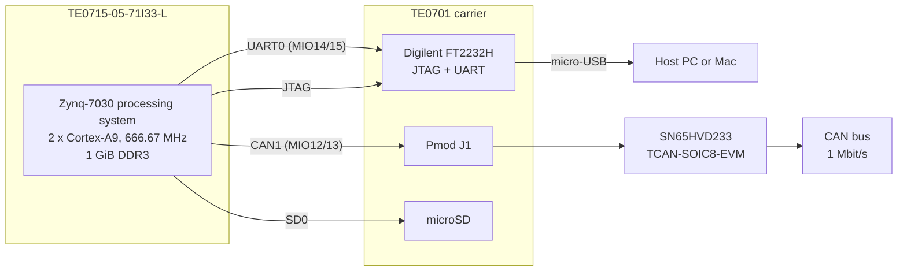
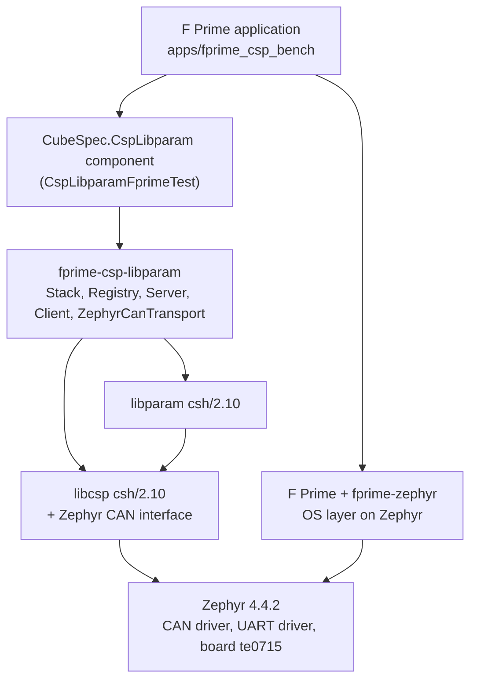

# System overview

## Hardware

The Zynq-7030 combines an ARM processing system (PS) with programmable logic (PL).
This project only uses the PS; the FPGA bitstream that the SD card's boot loader
loads is not needed by Zephyr. Zephyr runs on the first Cortex-A9 core.

## Software

The software is layered so that each piece can be tested on its own, and so that
the F Prime code is the same as on the Linux bench:

| Layer | Provided by | Changed in this project |
|---|---|---|
| Application, topology, serial shell | `app/apps/fprime_csp_bench` | new |
| `CspLibparam` component | CspLibparamFprimeTest | transport chosen per platform |
| CSP/libparam integration | fprime-csp-libparam | new `ZephyrCanTransport` |
| OS layer | fprime-zephyr | task stack size and priority fixes (patches) |
| CSP, parameters | libcsp, libparam `csh/2.10` | two build patches |
| Drivers, board | Zephyr | new CAN driver, UART fixes, new board |

## The pages in this section

- [Board support](board.md): what the `te0715` board definition sets up.
- [CAN driver](can-driver.md): the new driver for the Zynq's CAN controllers.
- [UART driver fixes](uart-driver.md): three bugs found in the console driver.
- [F Prime on Zephyr](fprime.md): how the F Prime build, topology and threads work.
- [Dependencies and patches](dependencies.md): pinned revisions and every patch.
