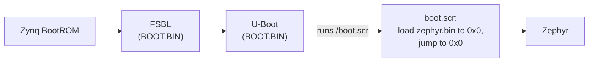

# Booting over JTAG or from the SD card

The TE0715 can run a Zephyr image in two ways. During development, images are
loaded over **JTAG** straight into memory. For use without a PC, such as on the
FlatSat, the board boots from its **SD card**.

| | JTAG | SD card |
|---|---|---|
| Needs a PC with the JTAG cable and `xsdb` | yes | no |
| Changes anything on the board | no: the image is only in RAM | replaces `zephyr.bin` and `boot.scr` on the card |
| Survives a power cycle | no | yes |
| Processor initialisation | `ps7_init.tcl` from the reference design, run by `xsdb` | the FSBL on the card (same reference design) |
| Typical use | development, the bench tests | FlatSat, demonstrations |

## Loading over JTAG

```bash
PATH=/tools/Xilinx/Vitis/2022.1/bin:$PATH west flash -d build/<app>
# or, for the F Prime application:
xsdb app/boards/trenz/te0715/support/xsdb.cfg \
    app/apps/fprime_csp_bench/build-fprime-automatic-zephyr/zephyr/zephyr.elf
```

The script resets the whole processing system, which also interrupts whatever the
board was running, and then loads and starts the image.

## Booting from the SD card

The SD card came with PetaLinux. Its boot files are left in place, and only the last
step of the boot is redirected to Zephyr:



This is the method that Zephyr's own documentation describes for Zynq-7000 boards.
The files on the card's first (FAT) partition are:

| File | Contents |
|---|---|
| `BOOT.BIN` | FSBL, FPGA bitstream and U-Boot (unchanged) |
| `image.ub` | PetaLinux kernel and root file system (unchanged, unused while Zephyr boots) |
| `boot.scr` | Script that boots Zephyr (replaced) |
| `boot_petalinux.scr` | The original PetaLinux `boot.scr`, kept as a backup |
| `zephyr.bin` | The Zephyr image |

### Installing or updating the image

With the board on the JTAG/UART cable:

```bash
app/scripts/sd_install.py install \
    app/apps/fprime_csp_bench/build-fprime-automatic-zephyr/zephyr/zephyr.bin
```

The card does not have to be removed. The script:

1. resets the board and stops U-Boot at its prompt over the serial console;
2. saves PetaLinux's `boot.scr` as `boot_petalinux.scr`, but only if no backup exists
   yet, so running the script again never overwrites the original;
3. copies `zephyr.bin` and the new `boot.scr` into the board's memory over JTAG;
4. lets U-Boot check the script image and write both files to the card.

Afterwards, reset or power-cycle the board to boot the new image.

With a card reader instead: rename `boot.scr` on the card to `boot_petalinux.scr`,
and copy `zephyr.bin` and a new `boot.scr` onto it. Make the script with
`python3 app/boot/mkscr.py app/boot/boot.cmd boot.scr`.

### Going back to PetaLinux

```bash
app/scripts/sd_install.py restore
```

Without the PC, at the U-Boot prompt (press a key when `Hit any key to stop
autoboot` appears):

```text
fatload mmc 0 0x3000000 boot_petalinux.scr
fatwrite mmc 0 0x3000000 boot.scr ${filesize}
reset
```

To boot PetaLinux once without changing the card, stop autoboot and type
`fatload mmc 0 0x3000000 boot_petalinux.scr; source 0x3000000`.

## Restarting

| How | Effect |
|---|---|
| Power cycle | Boots from the SD card |
| `kernel reboot cold` in the shell | Software reset of the processing system; boots from the SD card |
| JTAG reset (`sd_install.py`, `xsdb`) | Boots from the SD card, unless an image is loaded right after |
