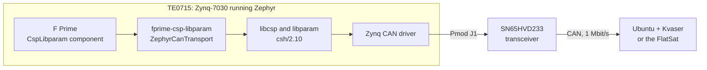

# TE0715 Zephyr bring-up

This project runs the CubeSpec CSP/libparam flight-software stack on a Trenz TE0715
system-on-module under the Zephyr RTOS, and connects it to a CAN bus through the
TE0701 carrier board.

The starting point was a TE0715 that only ran PetaLinux. Four things were needed
to get from there to a flight-software test bench:

1. **Zephyr on the board.** Zephyr supports the Zynq-7000, but not this module:
   the project adds a `te0715` board (clocks, memory, pins, JTAG loading) and fixes
   three bugs in Zephyr's Zynq UART driver that the board's tests exposed.
2. **A CAN bus.** Zephyr had no driver for the Zynq's CAN controllers. The project
   adds one, routes the second controller to the carrier's Pmod J1 connector, and
   connects it to an external TI SN65HVD233 transceiver.
3. **CSP and libparam.** The Space Inventor `csh/2.10` releases of libcsp and
   libparam are built as Zephyr modules, with two small portability patches.
4. **F Prime.** The CubeSpec `CspLibparam` component, the same one that the Linux
   acceptance bench ([CspLibparamFprimeTest](https://github.com/SiboVG/CspLibparamFprimeTest))
   runs, now runs on Zephyr through fprime-zephyr and a new Zephyr CAN transport in
   [fprime-csp-libparam](https://github.com/SiboVG/fprime-csp-libparam).

## Current status

| Capability | Status |
|---|---|
| Zephyr boots on the TE0715 over JTAG and from the SD card | Verified on hardware |
| Console UART driver fixes | Verified on hardware; upstream PR [#119996](https://github.com/zephyrproject-rtos/zephyr/pull/119996) open |
| Zynq CAN driver: Zephyr test suites | Verified on hardware, on Zephyr v4.4.2 and upstream `main` |
| CAN traffic with an independent controller (Kvaser) at 1 Mbit/s | Verified on hardware |
| F Prime CSP/libparam server interoperating with the Linux bench | Verified on hardware |
| LED D4 switched remotely through the libparam parameter `led_d4` | Verified on hardware |
| CSP keeps working when nobody acknowledges on the bus; node stored on the SD card | Verified on hardware |
| Operation on the FlatSat bus | Pending hardware execution |

The detailed traceability is in [Requirements and verification](verification/requirements.md),
and the results of the latest full test run in the
[as-run record of 2026-09-24](verification/as-run-2026-09-24.md) (the earlier runs: [2026-09-23](verification/as-run-2026-09-23.md)).

## How to use these docs

| If you want to... | Read |
|---|---|
| set up the workspace and build everything | [Getting started](getting-started/index.md) |
| talk to the board and use its commands | [User guide](guide/connect.md) |
| understand how the pieces fit together | [Architecture](architecture/index.md) |
| repeat a test | [Test guides](tests/index.md) |
| run the FlatSat test | [FlatSat test from macOS](tests/flatsat.md) |
| cite results | [Verification](verification/requirements.md) |
