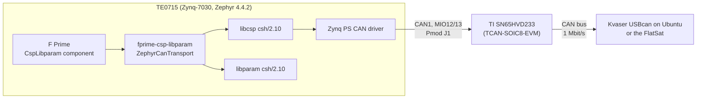

# TE0715 Zephyr, CAN and F Prime bring-up

This repository brings up [Zephyr](https://zephyrproject.org) on the Trenz
TE0715-05-71I33-L system-on-module (AMD Zynq-7030) on a TE0701 carrier, adds a CAN
bus on the carrier's Pmod J1, and runs the CubeSpec F Prime CSP/libparam stack on
it: the same `CspLibparam` component that the Linux acceptance bench
([CspLibparamFprimeTest](https://github.com/SiboVG/CspLibparamFprimeTest)) runs,
now over a Zephyr CAN transport.

## Status

| Layer | Result |
|---|---|
| Zephyr on the TE0715 (out-of-tree board `te0715`) | Boots over JTAG and from the SD card; kernel suites pass |
| UART driver (`uart_xlnx_ps`) | Three fixes, upstream PR [#119996](https://github.com/zephyrproject-rtos/zephyr/pull/119996); `uart_basic_api` 7/7 without garbling |
| CAN driver for the Zynq PS CAN controller | New; `tests/drivers/can/api` and `timing` pass on v4.4.2 and on upstream `main`; 1000/1000 frames echoed over a real bus |
| libcsp and libparam `csh/2.10` | Built as Zephyr modules (two small patches) |
| F Prime (fprime-zephyr) | `CspBench` server role runs; the unmodified Linux `CspBench` client passes 5/5 ping, read, write and restore cycles |
| Standalone boot | From the SD card through the existing U-Boot; CSP ready 13.4 s after reset |

See [Tests](tests/index.md) for the procedures and [Results](tests/results.md) for
the logs.

## Repositories and branches

| Repository | Branch | Contents |
|---|---|---|
| this repository (`app`) | `main` | West manifest, `te0715` board, apps, scripts, patches, these docs |
| [SiboVG/zephyr](https://github.com/SiboVG/zephyr) | `te0715-can-v4.4.2` | Zephyr v4.4.2 + UART fixes + CAN driver (pinned by `west.yml`) |
| | `xuartps-fixes` | UART fixes on upstream `main` (PR #119996) |
| | `xlnx-can` | CAN driver on upstream `main`, independent of the UART fixes (for a PR) |
| [SiboVG/fprime-csp-libparam](https://github.com/SiboVG/fprime-csp-libparam) | `zephyr-can-transport` | `ZephyrCanTransport`, POSIX-only thread library |
| [SiboVG/CspLibparamFprimeTest](https://github.com/SiboVG/CspLibparamFprimeTest) | `zephyr-transport` | `CspLibparam` selects the Zephyr transport on Zephyr builds |

## Applications

| Directory | What it does |
|---|---|
| `.` (`src/main.c`) | Blinks LED D4 (MIO7) and toggles MIO9 on Pmod J1 |
| `apps/can_bringup` | Echoes CAN ID 0x100 as 0x101 and sends a 1 Hz heartbeat on 0x7F0 |
| `apps/csp_node` | Plain libcsp node with the CSP services and a libparam server |
| `apps/fprime_csp_bench` | F Prime `CspBench` server role with a serial shell (the FlatSat image) |
