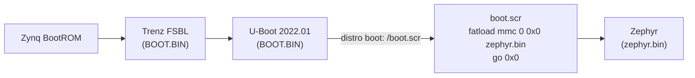

# SD card boot

The board boots Zephyr on its own (no JTAG) through the FSBL and U-Boot that are
already on the SD card for PetaLinux:



This is the U-Boot method from Zephyr's Zynq documentation. The FSBL initialises the
PS (clocks, DDR, MIO) from the same reference design as the JTAG script, and U-Boot
leaves DDR at address 0 free. `BOOT.BIN` and the PetaLinux `image.ub` stay on the
card; only `boot.scr` is replaced.

## Card contents after installation

| File | Origin |
|---|---|
| `BOOT.BIN` | unchanged: FSBL + bitstream + U-Boot |
| `image.ub` | unchanged: PetaLinux kernel + root filesystem |
| `boot.scr` | new: `boot/boot.cmd` wrapped by `boot/mkscr.py` (208 bytes) |
| `boot_petalinux.scr` | backup of the original `boot.scr` (2776 bytes) |
| `zephyr.bin` | the image to boot, e.g. the FlatSat image (312 KiB) |

## Install or update the image

```bash
app/scripts/sd_install.py install \
    app/apps/fprime_csp_bench/build-fprime-automatic-zephyr/zephyr/zephyr.bin
```

The script resets the board over JTAG, stops U-Boot's autoboot on the console,
copies `zephyr.bin` and the new `boot.scr` into DDR over JTAG, checks the script
image with `iminfo`, and writes both files with `fatwrite`. The card does not have
to be removed. The PetaLinux script is backed up only if no backup exists yet, so
repeated installs keep the original.

To use a card reader instead: copy `zephyr.bin` and a `boot.scr` made with
`python3 app/boot/mkscr.py app/boot/boot.cmd boot.scr` to the FAT partition,
after renaming the existing `boot.scr` to `boot_petalinux.scr`.

## Go back to PetaLinux

```bash
app/scripts/sd_install.py restore
```

or at the U-Boot prompt (press a key during `Hit any key to stop autoboot`):

```text
fatload mmc 0 0x3000000 boot_petalinux.scr
fatwrite mmc 0 0x3000000 boot.scr ${filesize}
reset
```

To boot PetaLinux once without changing the card, stop autoboot and run
`fatload mmc 0 0x3000000 boot_petalinux.scr; source 0x3000000`.

## Standalone boot test

After installation, reset the board (power cycle or JTAG reset without loading) and
run the end-to-end test against the image on the card:

```bash
app/scripts/fprime_e2e.py --bench path/to/CspBench --sd-boot --log sd-boot.log
```

Result (2026-09-23): U-Boot found `/boot.scr`, loaded `zephyr.bin` in 34 ms, the
start window expired, the server was ready on node 6061 14.7 s after reset, and all
13 checks passed, including the Linux client's 5/5 cycles.

```text
Found U-Boot script /boot.scr
## Executing script at 03000000
=== TE0715: booting Zephyr from zephyr.bin (restore PetaLinux: see docs/sd-card-boot.md) ===
312112 bytes read in 34 ms (8.8 MiB/s)
## Starting application at 0x00000000 ...
*** Booting Zephyr OS build v4.4.2-6-g70b56a29cd74 ***
*** CSP bench server: default node 6061/8. Type `bench start [node] [prefix]` within 10 s ...
[CSP_BENCH_READY] role=server can=can1 node=6061 peer=6061 param=200 type=u32 index=0
```
