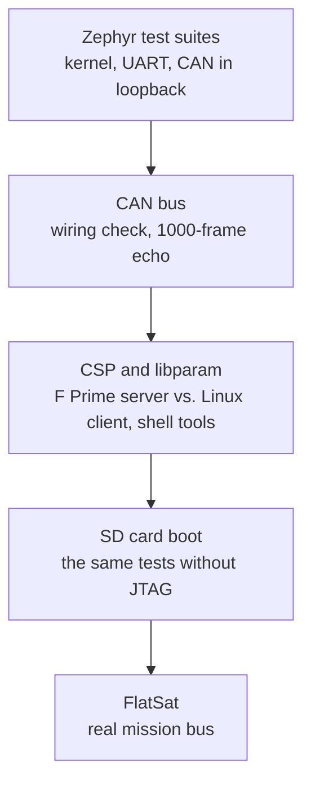

# Test guides

The tests build on each other, from the processor up to the complete F Prime
application. Each step only makes sense once the previous one passes, so a failure
points at a specific layer.



| Guide | Needs | Specification |
|---|---|---|
| [Hardware setup](hardware-setup.md) | – | – |
| [Zephyr test suites](zephyr-suites.md) | board on the JTAG/UART cable | TC-01 to TC-03 |
| [CAN bus](can-bus.md) | + transceiver, Kvaser | TC-04, TC-05 |
| [CSP and libparam with the Linux bench](csp-libparam.md) | + Linux CspBench | TC-06 to TC-08, TC-10 |
| [FlatSat test from macOS](flatsat.md) | FlatSat bus, a Mac | TC-09 |

The formal test case specifications, with pass criteria, are in
[Test case specifications](../verification/test-cases.md).

## Running all bench tests at once

```bash
app/scripts/collect_results.sh \
    ../CspLibparamFprimeTest/build-artifacts/Linux/Deployments_CspBench/bin/CspBench can0
```

The script runs TC-01 to TC-08 in order (about 12 minutes) and writes every log to
`docs/verification/evidence/<date-time>/`, together with the exact revisions
(`environment.txt`) and checksums (`SHA256SUMS`). It needs the Kvaser interface up at
1 Mbit/s and the SD card prepared with the FlatSat image, and leaves the board running
that image. The exit status is 0 only if everything passed.

## The test tools

| Tool | What it does |
|---|---|
| `app/scripts/hw_test.py` | Builds a Zephyr test or application, loads it over JTAG and follows the console. `test` mode reports every suite and fails on garbled output; `run` mode shows an application's output |
| `app/scripts/can_echo_test.py` | The host side of the CAN echo test, over Linux SocketCAN, without extra packages |
| `app/scripts/fprime_e2e.py` | Runs the Linux CspBench client against the board, then drives the board's shell against a Linux CspBench server |
| `app/scripts/csh_check.py` | Runs a csh command file (e.g. `csh_tc10.csh`) against the board through a pty and logs csh and the board console together |
| `app/scripts/sd_install.py` | Installs an image on the SD card, or restores PetaLinux |
| `app/scripts/flatsat_console.py` | Logging serial console for Linux and macOS, interactive or with a command file |
