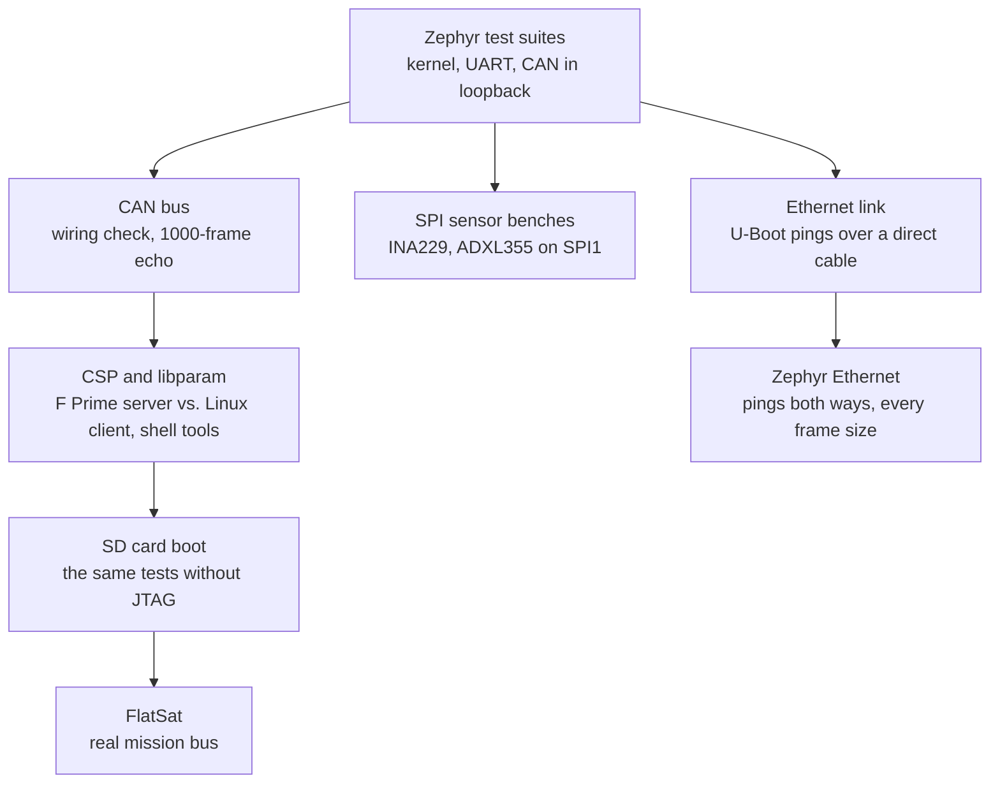

# Test guides

The tests build on each other, from the processor up to the complete F Prime
application. Each step only makes sense once the previous one passes, so a failure
points at a specific layer.



| Guide | Needs | Specification |
|---|---|---|
| [Hardware setup](hardware-setup.md) | – | – |
| [Zephyr test suites](zephyr-suites.md) | board on the JTAG/UART cable | TC-01 to TC-03 |
| [CAN bus](can-bus.md) | + transceiver, Kvaser | TC-04, TC-05 |
| [CSP and libparam with the Linux bench](csp-libparam.md) | + Linux CspBench | TC-06 to TC-08, TC-10 |
| [FlatSat test](flatsat.md) | FlatSat bus, a Mac or Linux laptop | TC-09 |
| [Ethernet link](ethernet.md) | board booting U-Boot from its SD card, a Linux host Ethernet port for the test, a network cable | TC-23, TC-24 |
| [SPI sensor benches](spi-sensors.md): [INA229](ina229.md), [ADXL355](adxl355.md) | board + a sensor on Pmod J1; reference instruments for TC-15 | TC-13 to TC-21 |

The formal test case specifications, with pass criteria, are in
[Test case specifications](../verification/test-cases.md).

## Running all bench tests at once

```bash
app/scripts/collect_results.sh \
    ../CspLibparamFprimeTest/build-artifacts/Linux/Deployments_CspBench/bin/CspBench can0
```

The script runs TC-01 to TC-08 in order (about 12 minutes) and writes every log to
`docs/verification/evidence/<date-time>/`, together with the exact revisions
(`environment.txt`) and checksums (`SHA256SUMS`). It needs the Kvaser interface up at
1 Mbit/s and the SD card prepared with the FlatSat image, and leaves the board running
that image. The exit status is 0 only if everything passed.

## The test tools

| Tool | What it does |
|---|---|
| `app/scripts/hw_test.py` | Builds a Zephyr test or application, loads it over JTAG and follows the console. `test` mode reports every suite and fails on garbled output; `run` mode shows an application's output |
| `app/scripts/can_echo_test.py` | The host side of the CAN echo test, over Linux SocketCAN, without extra packages |
| `app/scripts/fprime_e2e.py` | Runs the Linux CspBench client against the board, then drives the board's shell against a Linux CspBench server |
| `app/scripts/csh_check.py` | Runs a csh command file (e.g. `csh_tc10.csh`) against the board through a pty and logs csh and the board console together |
| `app/scripts/sd_install.py` | Installs an image on the SD card, or restores PetaLinux |
| `app/scripts/uboot_eth_check.py` | Checks the Ethernet link from U-Boot: pings a directly connected host, reads the PHY's speed and duplex and the host's receive counters, and writes an evidence package with checksums (TC-23) |
| `app/scripts/zephyr_eth_check.py` | Checks Zephyr's Ethernet (`apps/eth_bringup`): pings the board from the host at every frame size class and the host from the board's shell, reads `net iface` and `net stats` and the host's counters, and writes an evidence package with checksums (TC-24) |
| `app/scripts/flatsat_console.py` | Logging serial console for Linux and macOS, interactive or with a command file |
| `app/scripts/sensor_bench.py` | Runs the INA229 or ADXL355 bench's test cases over the shell (and the operator steps with `--interactive`), and writes an evidence package with checksums |

## Tests without hardware (CI)

GitHub Actions runs these on every push and pull request (`.github/workflows/`):

| Job | What it checks | Run locally |
|---|---|---|
| Host scripts (pytest) | `app/tests/scripts/`: the `boot.scr` image passes U-Boot's checks; `sd_install.py` backs up PetaLinux's `boot.scr` once, never overwrites the backup, and writes nothing if the script image is bad; console, logger and csh transcript helpers; `sensor_bench.py`'s pass criteria against simulated healthy and faulty sensor consoles; `uboot_eth_check.py`'s pass criteria, U-Boot and PHY parsing, host checks, and that it changes nothing persistent on the board; `zephyr_eth_check.py`'s pass criteria and parsing of `ping`, `net ping` and `net iface` output | `.venv/bin/python -m pytest app/tests/scripts` |
| Firmware unit tests (ztest) | `app/tests/bench/` on `native_sim`: the shell's number and value parsing, and the `te0715.txt` board configuration. What `param set` sends to another node must be exactly the typed value: out-of-range values (`u8 300`, `i8 -129`, `float 1e39`), negative unsigned values and non-numbers are refused, not truncated | `zephyr/scripts/twister -T app/tests -p native_sim/native/64` |
| Build for the TE0715 | The LED demo (also with SPI1 enabled), `can_bringup`, `eth_bringup` and `csp_node` build for `te0715` with the Zephyr SDK, and so do the unit tests | `west build -b te0715 ...` as in [Building and running](../getting-started/build-and-run.md) |
| Static analysis | cppcheck 2.22.0 and clang-tidy 22.1.8 report zero findings on the first-party C code of the builds above (in the *Build for the TE0715* job) | `python3 app/scripts/static_analysis.py --build demo ...`, see [Static analysis](../getting-started/static-analysis.md) |
| Docs | `mkdocs build --strict`; on `main` the site is published to GitHub Pages | `.venv-docs/bin/mkdocs build --strict` |

The F Prime images are not built in CI: they need the library checkouts next to the
workspace (CspLibparamFprimeTest and fprime-csp-libparam, fprime-ina229, fprime-adxl355)
and F Prime itself (about 700 MB).
