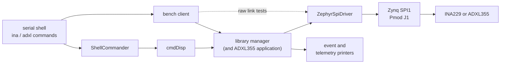

# SPI sensor benches

Two benches run the reusable F Prime sensor libraries on the TE0715 against real
sensors, one sensor at a time, on the processing system's SPI1 controller routed to
Pmod J1:

| Bench | Image | Library | Guide |
|---|---|---|---|
| INA229 power monitor | `app/apps/fprime_ina229_bench` | [fprime-ina229](https://github.com/SiboVG/fprime-ina229) | [INA229 bench](ina229.md) |
| ADXL355 accelerometer | `app/apps/fprime_adxl355_bench` | fprime-adxl355 | [ADXL355 bench](adxl355.md) |

Each image contains the library's F Prime components unchanged, fprime-zephyr's
`ZephyrSpiDriver`, a command dispatcher, and printers for events and telemetry on the
console. The serial shell is the operator interface: its commands call the manager's
ports as a flight application would, or send the library's F Prime commands through
the command dispatcher, the same path a ground command takes.



## What the benches show, and what they do not

They show that the TE0715 board support drives SPI1 correctly across its clock range,
that the libraries work on real silicon through the F Prime SPI port, and how long
their operations take on the Zynq with Zephyr. They also exercise the libraries'
fault handling with real faults.

They do not qualify a flight SPI implementation, the seven-sensor ADXL355 array, its
external synchronization, or measurement accuracy beyond the instruments used. Each
library lists the hardware work that remains open (`docs/verification.md` of
fprime-ina229, `docs/testing.md` of fprime-adxl355); the test cases below name the
items they cover.

## Wiring on Pmod J1

With the power off, connect the sensor board with short jumper leads (under 20 cm):

| Pmod J1 pin | Zynq pin | Signal | INA229 | ADXL355 |
|---|---|---|---|---|
| 8 | MIO10 | SPI1 MOSI | SDI | MOSI (SDI) |
| 9 | MIO11 | SPI1 MISO | SDO | MISO (SDO) |
| 10 | MIO12 | SPI1 SCLK | SCLK | SCLK |
| 7 | MIO13 | chip select, SPI1 SS0, active low | CS | CS |
| 6 | – | 3.3 V | VS | VSUPPLY and VDDIO |
| 12 | – | GND | GND | GND |

!!! danger "Do not plug a Pmod module into J1"
    A Pmod SPI module (for example Analog Devices' EVAL-ADXL355-PMDZ) puts CS, MOSI,
    MISO and SCLK on pins 1 to 4. On Pmod J1 of the TE0701 those are MIO0, MIO9 and the
    console UART (MIO14 and MIO15), and the power pins differ as well. Always wire the
    signals by hand as in the table.

!!! warning "3.3 V only"
    MIO bank 0 runs at 3.3 V. Supply the sensor from Pmod J1 pin 6 or from another
    3.3 V rail: the INA229 drives MISO up to its supply VS, and the ADXL355 allows
    at most 3.6 V on VDDIO. Measure the power pins first, as in
    [Hardware setup](hardware-setup.md#1-connect-the-transceiver-to-pmod-j1).

Further points:

- MIO12 and MIO13 also carry CAN1 (`te0701-can1.overlay`). Disconnect the CAN
  transceiver while a sensor bench runs.
- MIO10 and MIO11 also reach the TE0701 CPLD, which the Trenz documentation gives an
  I2C slave on these pins. If it mistook SPI traffic for an I2C transfer addressed to
  it, it could pull a line low during a transfer. The soak steps (TC-13, TC-17) are
  meant to catch that; capture a few transfers with a logic analyzer as well.
- MIO11 (MISO) has its pull-up enabled, so an unconnected or unselected sensor reads
  as all ones.
- The chip select is SPI1's own SS0, not a GPIO: the controller does not transfer while
  its SS0 input is low, which it is when SS0 is not on a pin (see
  [Board support](../architecture/board.md#spi-controllers)).
- For waveform captures, connect a logic analyzer to Pmod J1 pins 7 to 10 and GND.

## SPI clock and mode

SPI1 runs from SPI_REF_CLK = 142.86 MHz (IO PLL / 7, set by `board.c`), which the
controller divides by 4 to 256. The driver takes the fastest division that does not
exceed the requested clock:

| Request (Hz) | SCLK | Used by |
|---|---|---|
| 600000 | 558.0 kHz | slowest; soak |
| 1200000 | 1.116 MHz | default at boot; soak |
| 2300000 | 2.232 MHz | soak |
| 4500000 | 4.464 MHz | soak |
| 9000000 | 8.929 MHz | fastest within the sensors' 10 MHz limit; soak |

`ina spi` and `adxl spi` show and change the setting; the SCLK they print is the one
the driver selects. The INA229 uses SPI mode 1 by default (SCLK idle low, MOSI
sampled on falling edges, data sheet SLYS023A 6.7), the ADXL355 mode 0.

## Building

The benches are F Prime projects, like `apps/fprime_csp_bench`. The library is a
checkout next to the workspace (see [The workspace](../getting-started/index.md)):
`../fprime-ina229` or `../fprime-adxl355`.

```bash
cd app/apps/fprime_ina229_bench        # or fprime_adxl355_bench
fprime-util generate
fprime-util build -j16
```

The image is `build-fprime-automatic-zephyr/zephyr/zephyr.elf` (JTAG) or
`zephyr.bin` (SD card). The boot banner and `ina info` / `adxl info` print the bench
and library revisions the image was built from; `-dirty` marks uncommitted changes.

!!! note "CubeSpec FlightSoftware workspace"
    In the CubeSpec FlightSoftware workspace the libraries live in `libraries/`. Link
    them next to the bench workspace once:
    `ln -s ../../libraries/fprime-ina229 verification/benches/fprime-ina229` and the
    same for `fprime-adxl355`.

## Running the tests

Load the image and wait for the ready marker (`[INA229_BENCH_READY]` or
`[ADXL355_BENCH_READY]`):

```bash
xsdb app/boards/trenz/te0715/support/xsdb.cfg \
    app/apps/fprime_ina229_bench/build-fprime-automatic-zephyr/zephyr/zephyr.elf
```

`app/scripts/sensor_bench.py` runs a bench's test cases and keeps the evidence. It
loads the image (`--elf`), boots it from the SD card (`--sd-boot`) or uses the image
already running (`--attach`); with `--interactive` it also runs the operator steps.

```bash
out=docs/verification/evidence/$(date +%Y-%m-%d-%H%M)-ina229
app/scripts/sensor_bench.py ina229 --elf <zephyr.elf> --shunt 0.015 --max-current 5 \
    --interactive --out "$out"
```

It writes `transcript.log` (the whole console), `results.txt` (one PASS, FAIL or INFO
line per step, with the measured values), `environment.txt` and `SHA256SUMS`. Assess
the package in an as-run record from the
[sensor bench record template](../verification/sensor-record-template.md).

## Output conventions

Every bench command prints one result line that starts with a marker (`INA_ID`,
`ADXL_SOAK`, ...) followed by `key=value` fields; readings are CSV rows (`INA_ROW`,
`ADXL_ROW`, `ADXL_FRAME`) after a header line. Events appear as
`EVENT: (id) (time) name: text` from F Prime's text logger, and telemetry as
`TLM <instance>.<channel> = <value> (<time>)` when the manager writes it.
